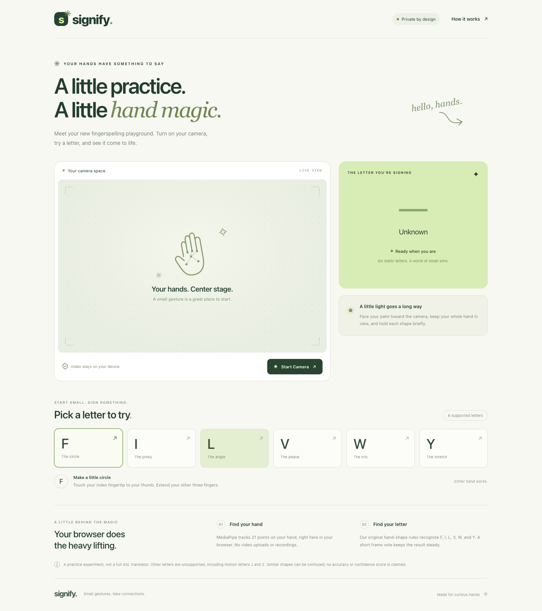

# Signify

**A real-time ASL fingerspelling playground that runs entirely in your browser.**

[Try the live demo](https://signify-tau-six.vercel.app/) · [Development guide](web/README.md) · [Python demo](docs/python-demo.md)

Signify uses your webcam to track your hand and recognize six static ASL letters: **F, I, L, V, W, and Y**. Choose a letter for step-by-step text cues, hold the handshape, and watch the result appear. Video processing stays on your device.



*Application screenshot with the camera off; no webcam image is recorded.*

## Features

- Mirrored webcam feed with a 21-point hand-landmark overlay.
- Prominent letter results, frame-based smoothing, and an **Unknown** state for rejected or unstable predictions.
- Interactive instructions for each supported sign and a responsive layout.
- Explicit Start/Stop controls, permission-error guidance, and **Esc** to stop. Hiding the tab releases the camera.
- Local inference in a Web Worker, with no video uploads, recordings, accounts, or API keys.

## How it works

```text
Webcam → MediaPipe Hand Landmarker → normalized hand geometry
       → six-letter rules → frame vote → React interface
```

MediaPipe's pretrained model locates the hand's 21 landmarks. A TypeScript port of the original Python classifier normalizes them by palm size and checks finger bending, separation, thumb placement, and hand orientation. The **letter classifier uses geometry rules**, not a trained ASL neural network or MediaPipe's generic gesture labels.

A six-of-eight-frame vote stabilizes predictions. Three consecutive rejected frames clear a result; hand loss resets it immediately. The worker processes one frame at a time, with a roughly 25 FPS processing cap, to avoid accumulating stale frames. Letter confidence scores are not available and are not displayed.

**Stack:** React, TypeScript, Vite, MediaPipe Tasks Vision, WebAssembly, Web Workers, Vitest, Playwright, GitHub Actions, and Vercel. The independent Python demo uses OpenCV, MediaPipe Hands, and NumPy.

## Run locally

Requires **Node.js 22** and npm. Python is not needed for the web app.

```sh
git clone https://github.com/bjoseph124/Signify.git
cd Signify/web
npm ci
npm run dev
```

Open the printed localhost URL and click **Start Camera**. Keep one upright hand fully visible, palm facing the camera. Select a letter card for instructions.

Camera access requires HTTPS or localhost. If permission is denied, allow Camera in your browser's site settings. On macOS, also enable your browser under **System Settings → Privacy & Security → Camera**. See the [development guide](web/README.md#troubleshooting) for more troubleshooting.

## Tests and production build

From `web/`:

```sh
npm test
npm run build
npm run test:browser
```

Browser tests use installed Google Chrome and a simulated webcam. On other systems, set `CHROME_PATH` to your Chrome executable. They cover responsive layout, instructions, real MediaPipe initialization, camera cleanup, and error handling. Classifier fixtures check Python/TypeScript parity and smoothing; they do not measure real-world ASL accuracy.

Run `python3 -m unittest discover -s tests -v` from the repository root for the independent Python rule tests. To inspect the web production build locally, run `npm run preview` from `web/`.

**Deployment:** Vercel builds `main` with root directory `web`, Node 22, `npm ci`, `npm run build`, and output directory `dist`. No environment variables are required. Model and WASM assets are served from the same origin. See [deployment details](web/README.md#deployment-through-github-and-vercel).

## Project layout

| Path | Purpose |
| --- | --- |
| `web/src/classifier.ts` | Six-letter geometry rules and smoothing |
| `web/src/tracker.worker.ts` | Local MediaPipe inference |
| `web/src/useCamera.ts` | Camera permissions, frame scheduling, and cleanup |
| `web/src/App.tsx` | Webcam interface and interactive signing cues |
| `web/tests/` | Browser integration tests |
| `app.py`, `recognition.py`, `tests/` | Preserved Python demo and tests |

## Limitations

Recognition supports **six static letters only**. J and Z require movement and are unsupported, as are the other 18 letters. Similar unsupported handshapes can still produce false positives. Lighting, occlusion, hand orientation, and signer variation affect results.

All six letters have been manually tested on the live application, but representative accuracy across signers and devices has not been established. Automated browser coverage uses desktop Chrome; mobile and other browsers need further hands-on testing. This is a practice demo, not an ASL translator or a substitute for instruction from qualified ASL educators.

An expanded neural-network classifier was evaluated on the separate `feat/full-alphabet-research` branch. Its results were insufficient for production; it is not part of this application.

## Acknowledgments and licensing

Hand tracking is powered by [Google MediaPipe](https://ai.google.dev/edge/mediapipe/solutions/vision/hand_landmarker). See [third-party notices](THIRD_PARTY_NOTICES.md) for model provenance and dependency licenses. The production app includes no ASL training dataset or external font files; its interface illustrations are SVGs in the source.

Signify's original code is available under the [MIT License](LICENSE), copyright 2026 Benjamin Joseph. Third-party components retain their own licenses and attribution requirements as documented above.
