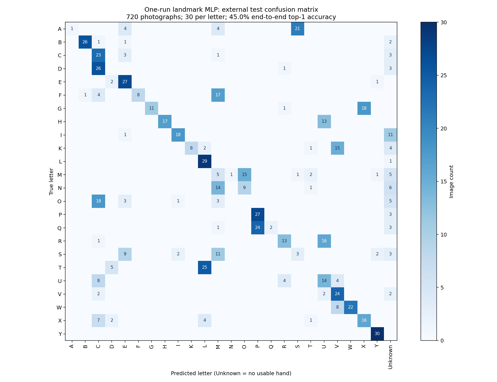

# One practical static-alphabet attempt

**Decision: keep the six-letter production classifier.** A tiny landmark network is technically easy to train and run locally, but the readily usable data tested here does not yield a reliable 24-letter replacement. We stopped after one model fit. No production code, J/Z code, repository visibility, or merge changed.

## Dataset triage

| Source | License / data quality | Decision |
| --- | --- | --- |
| [Ayush Thakur ASL Dataset](https://www.kaggle.com/datasets/ayuraj/asl-dataset) | Publisher metadata: CC0, version 1. 2,515 unique images including digits and static J/Z poses. Tight segmented black-background crops. Five `handN` filename groups, but the primary description does not establish five distinct signers or identify ASL proficiency. | Small enough for this bounded attempt; use only the 1,675 static-letter images, hold out complete filename groups. |
| [Dan Rasband ASL Alphabet Test](https://www.kaggle.com/datasets/danrasband/asl-alphabet-test) | Publisher metadata: CC0, version 1. Different photographic backgrounds. No verified signer identifiers. Archive repeats the same collection in a nested directory. | Use 720 unique static-letter images as an external test. No exact SHA-256 overlap with training data. |
| [Helios landmark dataset/model](https://github.com/bgraudt/helios/blob/main/MODEL_CARD.md) | Model card lists normalized 63D features and 26 static classes, but does not establish signer-separated evaluation. Repository code licensing alone does not settle the source landmark dataset's provenance. J/Z treated as static labels. | Not enough documented provenance/partition information to prefer it over extracting with our exact tracker. |
| [ASL-HG article](https://www.sciencedirect.com/science/article/pii/S2352340926000454) | Published collection: 36,000 images from ten volunteers, static A–Z plus digits, raw/cropped variants and an 80/20 split. It describes a two-handed zero convention. A data-level license and signer-aware split would need verification before adoption. | Potential future data, but class conventions need an audit; a larger download/validation effort is outside this one-attempt scope. |
| [FSboard](https://arxiv.org/abs/2407.15806) | Far stronger documented diversity: 147 consenting Deaf signers and signer-separated sequence evaluation. Phrase-level fingerspelling, not ready-made isolated-frame letter labels. | Aligning sequences to static labels would turn this into the larger project the user wants to avoid. |

I visually checked representative A/D/G/H/K/M/N/P/Q/R/T photographs across all five `handN` groups. They broadly resemble the one-handed alphabet and preserve sideways G/H and downward P/Q. This was an engineering spot-check, **not ASL-expert annotation validation**. No signer identity was inferred from appearance. Still photographs labelled J/Z cannot validate their motion and were excluded along with all digits.

## Fixed experiment

- **Tracker:** the same browser MediaPipe Tasks Vision 1.1.0, same version-1 Hand Landmarker, CPU, 0.65 detection/presence/tracking thresholds. IMAGE mode processes independent photos; temporal webcam behavior remains untested. No synthetic landmarks were used to train or assess accuracy.
- **Split:** hand1/hand2/hand3 training (1,315 images); hand4 validation (120); hand5 held out (240). These are **filename-group holdouts, not proven signer holdouts**. Dan Rasband's 720 images are the external test. Existing nested archive duplicates were excluded, hashes deduplicated, and exact cross-source overlap checked.
- **Features:** aspect-correct y, subtract wrist, divide xyz by the wrist-to-middle-MCP distance. Keep orientation; rotating upright would erase useful distinctions. Training-only x reflection supports either hand. Standardize using training data only.
- **Model:** one scikit-learn MLP, 63 → 128 ReLU → 64 ReLU → 24 softmax, Adam, L2 0.001, seed 42, at most 250 iterations. It stopped at 140 without convergence warnings. No architecture or learning-rate search.
- **Rejection:** choose from a small fixed score/margin grid on validation only, maximizing coverage while requiring ≥90% accepted precision and ≥20 accepted images. Selected score ≥0.99 and margin ≥0.30; also require the app's in-frame check. Scores are not calibrated probabilities of correctness.
- **Data bottleneck:** only 679/1,315 training images yielded landmarks; 63/120 validation and 106/240 held-out-group images did. The tight crops and occluded fists are a poor fit to our tracker. Those failures remain in evaluation denominators.

The previous pretrained-model experiment already exposed this external test set. This new fit and threshold choice do not use its labels, but it is not a fresh blinded benchmark, and cross-source provenance cannot prove signer independence. There is no Unknown-negative set and no physical-webcam evaluation.

## Results

“Accuracy” counts a missed hand or rejected prediction as incorrect. “Accepted precision” measures correctness only when a letter is emitted. Coverage measures the fraction of all images with a letter emitted. All are per-image, without temporal smoothing; repeating the same photograph is not a valid temporal test.

| Evaluation | Raw top-1 accuracy | Gated accepted precision | Gated coverage | Gated end-to-end accuracy |
| --- | ---: | ---: | ---: | ---: |
| Validation, hand4 | 43.3% | 95.5% | 36.7% | 35.0% |
| Held-out filename group, hand5 | 36.7% | 93.8% | 27.1% | 25.4% |
| External 720 images | **45.0%** | **65.9%** | **34.6%** | **22.8%** |

Among detected external hands alone, raw top-1 accuracy is 48.4%. Reporting only detected hands would hide some failures. The external gate emitted 249 predictions: **164 correct, 85 incorrect**. A 0.99 model score clearly did not transfer into reliable real-world confidence.

### Fair comparison on the six shared letters

The old classifier intentionally cannot recognize 18 of the 24 letters. Its all-alphabet accuracy is therefore not a fair measure of regression. On the 180 external F/I/L/V/W/Y images:

| Classifier | Correct / all | Accepted precision | Coverage |
| --- | ---: | ---: | ---: |
| Existing six-letter rules | **121/180 (67.2%)** | **100%** | **67.2%** |
| New MLP, gated | 79/180 (43.9%) | 100% | 43.9% |
| New MLP, no rejection | 131/180 (72.8%) | 78.9% | 92.2% |

Thus the new model's extra guesses trade away reliability; it does not justify replacing the verified six-letter mode. On all 720 images the baseline emits 147 predictions, with 121 correct (82.3% accepted precision, 20.4% coverage); some unsupported shapes resemble one of its six letters. Neither method is a robust open-set classifier.

### External per-letter results

Each row has 30 images. Accuracy includes missed hands; gated coverage includes both confidence rejection and the in-frame check.

| Letter | Raw accuracy | Gated coverage | Letter | Raw accuracy | Gated coverage |
| --- | ---: | ---: | --- | ---: | ---: |
| A | 3.3% | 0.0% | N | 0.0% | 3.3% |
| B | 86.7% | 50.0% | O | 0.0% | 16.7% |
| C | 76.7% | 36.7% | P | 90.0% | 80.0% |
| D | 0.0% | 63.3% | Q | 6.7% | 43.3% |
| E | 90.0% | 36.7% | R | 43.3% | 40.0% |
| F | 26.7% | 3.3% | S | 10.0% | 0.0% |
| G | 36.7% | 26.7% | T | 0.0% | 43.3% |
| H | 56.7% | 53.3% | U | 46.7% | 36.7% |
| I | 60.0% | 53.3% | V | 80.0% | 33.3% |
| K | 26.7% | 26.7% | W | 73.3% | 23.3% |
| L | 96.7% | 76.7% | X | 53.3% | 3.3% |
| M | 16.7% | 6.7% | Y | 100.0% | 73.3% |



Machine-readable results:

- [Full report, per-letter results and all confusion matrices](reports/lightweight-static.json)
- [Per-letter CSV for all splits](reports/lightweight-per-letter.csv)
- External confusion matrices: [raw](reports/lightweight-confusion-top1.csv), [gated](reports/lightweight-confusion-gated.csv), [baseline](reports/lightweight-confusion-baseline.csv)
- [Python/TypeScript inference parity](reports/lightweight-parity.json): 40 real-image examples, no top-label disagreements, maximum probability difference below `1e-7`.
- [Research-only learned weights](models/lightweight-static.json) and [artifact notes](models/README.md)

## Reproduce the single attempt

From the repository root, Node 22 and local Chrome installed:

```sh
.venv/bin/python -m pip install -r research/requirements-training.txt
npm --prefix web ci
npm --prefix web run build
python3 research/scripts/prepare.py
curl -fL 'https://www.kaggle.com/api/v1/datasets/download/ayuraj/asl-dataset?datasetVersionNumber=1' -o research/.cache/ayuraj-v1.zip
python3 research/scripts/prepare-training.py
node research/scripts/extract-training.mjs
.venv/bin/python research/scripts/train-static.py
node research/scripts/check-trained-parity.mjs
.venv/bin/python -m unittest discover -s research/tests -v
```

Preparation checks the training archive hash recorded in the script/report. Raw photos and extraction records stay ignored. No camera is opened. The exported model is not installed in the website; reproducing it writes only to `.cache`. Committed `models/lightweight-static.json` preserves the evaluated artifact. `CHROME_PATH` overrides the Chrome executable.

## Is expansion practical for this side project?

**Training and browser execution are practical; dependable full-alphabet recognition from this readily usable data is not demonstrated.** More hyperparameter tweaking on these same photos is unlikely to resolve missing landmarks, thumb occlusion, label/signer uncertainty, and the large cross-dataset gap.

For a fun project, keep the six letters that already work. If desired later, a short, explicitly consented webcam check of the better-performing additional letters could assess a limited personalized extension, but image results alone do not justify enabling them. Reliable all-24 support across arbitrary visitors would require better curated/diverse data and real-webcam evaluation; this attempt gives no basis for promising it without additional collection or a better-validated dataset. J/Z remain separate, experimental, and unchanged.
